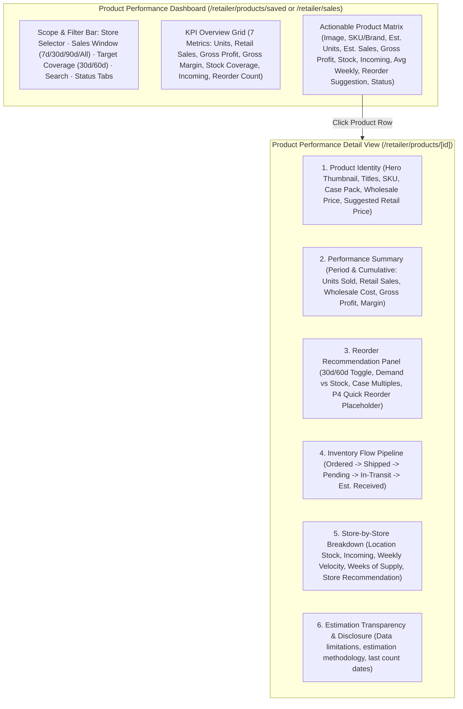
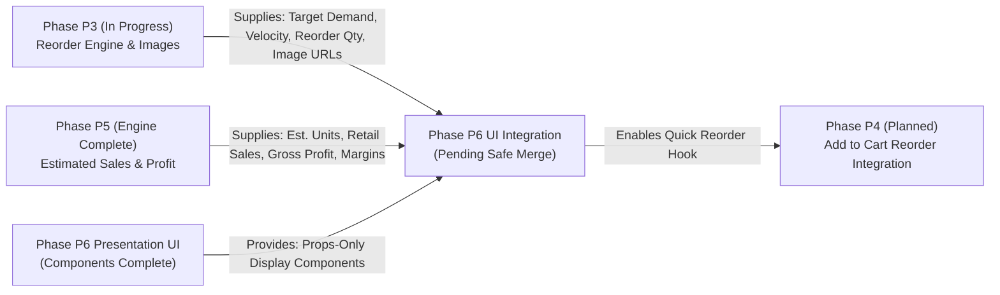

# Phase P6 — Product Performance UI/UX Design & Integration Specification

**Task ID**: `RTP-PERFORMANCE-P6-DESIGN-001`  
**Location**: `Retailer Portal > My Products > Product Performance / UI Design & Presentation Components`  
**Status**: `DESIGN COMPLETE / INTEGRATION PENDING`  
**Governance**: Adheres strictly to `DEPLOY-STD-001` and `CONCURRENT-DEV-001`

---

## 1. Executive Summary & Business Objective

K SELECT HUB Product Performance is an **approximate sales-analysis and stock replenishment support system**, intentionally distinct from a POS, ERP, or warehouse management system (WMS). Retailers do not provide granular receipt transactions, and suppliers do not expose confidential sourcing FOB.

The UI is designed to immediately answer three critical questions for retailers within 5 seconds of glance:
1. **How are my products performing?** (Estimated unit movement, retail sales revenue, gross profit, and weighted gross margin).
2. **How much inventory is available or incoming?** (Latest reported physical stock, in-transit shipments, pending dispatches, and post-report arrivals).
3. **Which products should I reorder, and how much?** (Automated case-pack replenishment recommendations targeting 30 or 60 days of forward demand).

---

## 2. Information Architecture (IA)

---

## 3. Dashboard Structure & Layout Specification

### 3.1 Scope & Filter Bar (Header Controls)
The filter bar enforces a strict mental model separation between **Historical Analysis Window** and **Future Reorder Target**:

| Control | Type | Options | Business Rule |
| :--- | :--- | :--- | :--- |
| **Location Scope** | Dropdown | Company-Wide (All Stores) vs Specific Store | Filters inventory, receipts, and sales to selected location without cross-store data leakage. |
| **Sales Window** | Button Pill Toggle | `7 Days` · `30 Days` · `90 Days` · `All Time` | Defines the historical interval window over which units moved, velocity, and revenue are computed. |
| **Reorder Target** | Button Pill Toggle | `30 Days` · `60 Days` | Defines the future forward-demand target for replenishment. **Never** alters the historical sales window. |
| **Search Filter** | Text Input | Real-time search by Product Name, SKU, or Brand Name | Instant client-side filtering across active catalog. |
| **Status Tabs** | Pill Badges | `All Products` · `Reorder Needed (Count)` · `Needs Review (Count)` · `Has Incoming Stock` | Focuses table view on actionable operational alerts. |

### 3.2 KPI Overview Grid
Seven primary metric cards arranged in logical reading order:

1. **Est. Units Sold**: Aggregate units depleted across valid observation intervals.
2. **Est. Retail Sales**: Estimated retail revenue ($) calculated using historical price snapshots or authorized SRP.
3. **Est. Gross Profit**: Merchandise gross profit ($) = Est. Retail Sales - Wholesale Merchandise Cost.
4. **Est. Gross Margin**: Weighted margin (%) = Total Gross Profit / Total Retail Sales $\times 100$. (Never an unweighted average of SKU percentages).
5. **Reported Stock Coverage**: Physical count coverage percentage across assigned stores (`Reporting Stores / Total Stores`).
6. **Incoming Stock**: Gross pipeline units (`In Transit + Pending Dispatches`).
7. **Reorder Needed SKU Count**: Actionable alert displaying the total number of SKUs requiring immediate purchase order placement.

#### State Representation Guidelines (No False Zeroes)
- When no inventory counts have been submitted or fewer than two consecutive counts exist, numerical metrics display **`Insufficient Data`** or **`Not Reported`** with a muted badge.
- **Never present unknown or unmeasured values as verified `$0.00` or `0 units`.**
- Genuine verified zero movement (e.g. stock remained exactly 20 across counts with 0 receipts) displays `0 units` with status `Available`.
- Anomalous stock gains without receipts display **`Needs Review`** with an amber warning indicator.

---

### 3.3 Product Matrix (Table & Mobile Cards)

#### Desktop Table Columns
1. **Product**: High-density thumbnail (40x40) with resilient fallback, Product Name, SKU, Brand Name, and Case Pack.
2. **Est. Units Sold**: Period units moved with font-bold highlight.
3. **Est. Retail Sales**: Formatted currency (`$X,XXX.XX`).
4. **Est. Gross Profit & Margin**: Gross profit in teal text with percentage margin stacked below.
5. **Reported Stock**: Latest verified physical inventory count with store count date tooltip.
6. **Incoming Qty**: Highlighted in amber (`+XX`) if pipeline exists, else muted `0`.
7. **Avg Weekly Sales**: Units/week velocity rate.
8. **Suggested Reorder**: Suggested reorder units and case count rounded to case multiples (e.g. `48 units (2 cases)`).
9. **Status**: Color-coded pill badge (`Reorder Needed`, `Sufficient Stock`, `Overstock`, `Insufficient Data`, `Needs Review`).

#### Mobile Layout Optimization
- Desktop tables collapse into compact, touch-friendly product cards.
- Sticky search and filter header with horizontal swipe for pills.
- High-priority metrics (Est. Sold, Est. Sales, Gross Profit) displayed in a 3-column micro-grid.
- Bottom card bar highlights current physical stock and suggested reorder quantity.

---

## 4. Product Detail Design (6-Section Architecture)

### Section 1: Product Identity
- Canonical product imagery adhering to P3 image resolution standards with graceful lettermark fallback.
- English & Korean product names, Letusto SKU, Manufacturer SKU, Category, and Carton Pack Qty (MOQ).
- Authorized Wholesale Purchase Price and Suggested Retail Price (SRP) with price-basis disclosure.

### Section 2: Performance Summary
- Dual-column comparison: **Selected Analysis Period** vs. **Cumulative (Since Baseline)**.
- Metrics: Units Sold, Retail Sales, Wholesale Merchandise Cost, Gross Profit, and Gross Margin.
- Clear disclosure: *"Estimated based on consecutive Weekly Inventory reports and SRP snapshots. Does not represent POS transactions or net profit."*

### Section 3: Reorder Recommendation Panel
- Interactive 30-day / 60-day target toggle.
- Clear visual formula breakdown:
  $$\text{Raw Need} = \text{Target Demand} - (\text{Reported Stock} + \text{Post-Report Receipts} + \text{Eligible Incoming})$$
  $$\text{Suggested Reorder} = \lceil \text{Raw Need} / \text{Carton Pack Qty} \rceil \times \text{Carton Pack Qty}$$
- **P4 Quick Reorder Placeholder**: Button labeled *"Add to Cart (Coming in Phase P4)"*, styled as disabled with standard cart icon, establishing an immediate anchor for Phase P4 without mutating cart state.

### Section 4: Inventory Flow Pipeline
- 5-step horizontal milestone tracker:
  1. **Ordered**: Purchase order commitment.
  2. **Shipped**: Warehouse fulfillment confirmed.
  3. **Pending**: Allocated but awaiting carrier dispatch.
  4. **In Transit**: Active tracking with next estimated arrival date.
  5. **Received**: Delivered or estimated store arrival.
- Special callout banner for **Post-Report Receipts**: Explains why shipments arriving after the last physical inventory count are credited to stock.

### Section 5: Store-by-Store Breakdown
- Granular breakdown table for multi-store retailers.
- Displays location-specific reported stock, incoming shipments, estimated movement, weekly sales velocity, weeks of supply, and store-specific reorder signals.

### Section 6: Estimation Transparency & Disclosure
- Formal footer note disclosing mathematical assumptions:
  - Inventory depletion model.
  - Absence of actual retail cash register data.
  - Rounding to whole case packs.

---

## 5. Isolated Presentation Component Inventory (`components/retailer/performance-ui/`)

To guarantee multi-agent safety under `CONCURRENT-DEV-001`, all presentation components have been created in an isolated directory without modifying existing files:

| Component | File | Purpose |
| :--- | :--- | :--- |
| `PerformanceKpiCard` | `performance-kpi-card.tsx` | Formats KPI values, supports `insufficient_data`, `not_reported`, `needs_review`, currency, and percent formatting. |
| `DataReliabilityBadge` | `data-reliability-badge.tsx` | Unified badge renderer for reorder signals and data reliability states. |
| `ReorderRecommendationPanel` | `reorder-recommendation-panel.tsx` | 30d/60d toggle, transparent stock calculation matrix, and P4 Add to Cart placeholder. |
| `InventoryFlowSummary` | `inventory-flow-summary.tsx` | 5-stage inventory pipeline tracker and post-report arrival callouts. |
| `StorePerformanceBreakdownView` | `store-performance-breakdown-view.tsx` | Responsive store-by-store comparison table and mobile card stack. |
| `PerformanceProductRow` | `performance-product-row.tsx` | High-density desktop table row and mobile responsive summary card. |
| `PerformanceFilterBar` | `performance-filter-bar.tsx` | Location selector, separate analysis window vs reorder target toggles, search, and filter pills. |
| `Index Barrel` | `index.ts` | Clean export of all components and TypeScript interfaces. |

---

## 6. Integration Contract & Next Tasks

### Integration Prerequisites:
1. Complete and deploy **Phase P3 (`RTP-PERFORMANCE-P3-001`)** with canonical image resolution and 30d/60d velocity models.
2. Verify SHA parity across origin/main.
3. Replace existing markup in `sales-performance-dashboard.tsx` and `product-performance-detail-view.tsx` by importing the isolated components from `@/components/retailer/performance-ui`.
4. Connect the P4 Add to Cart callback once the cart mutation API is released in Phase P4.
